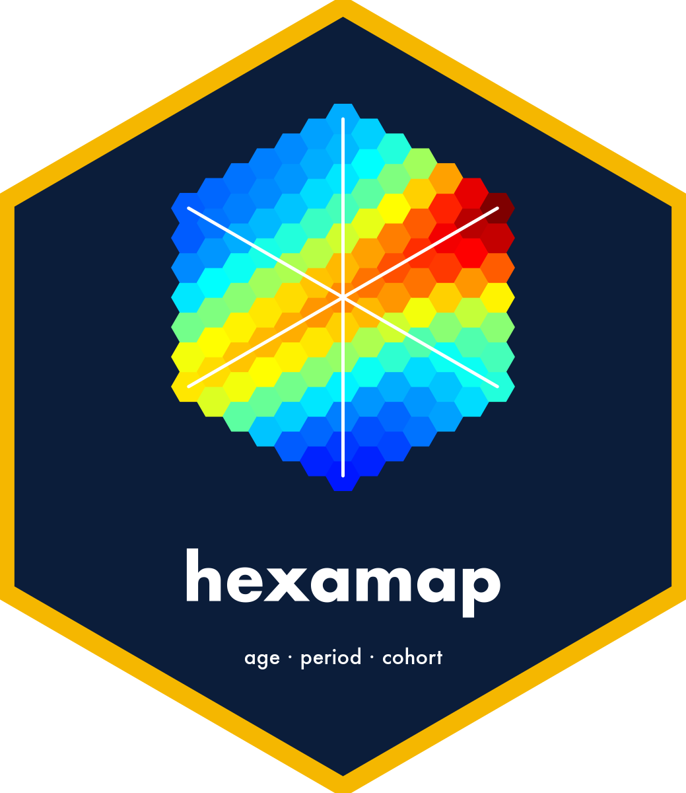
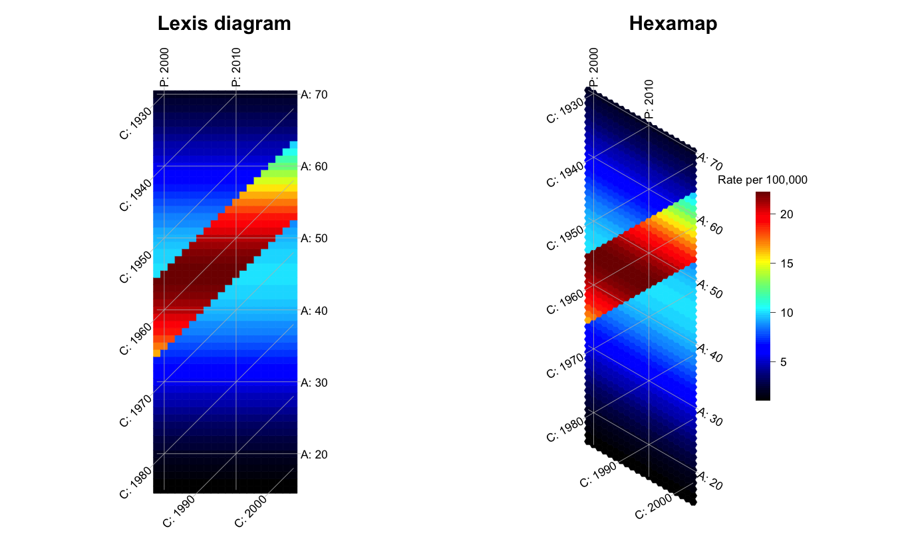
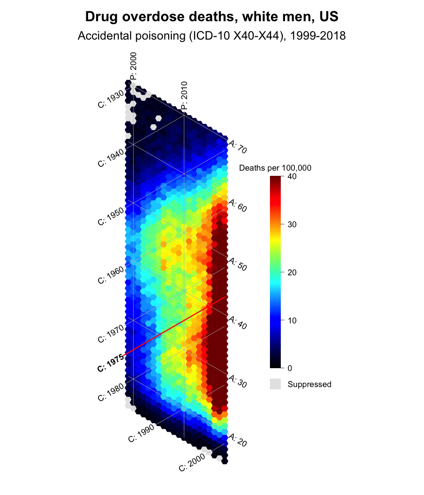
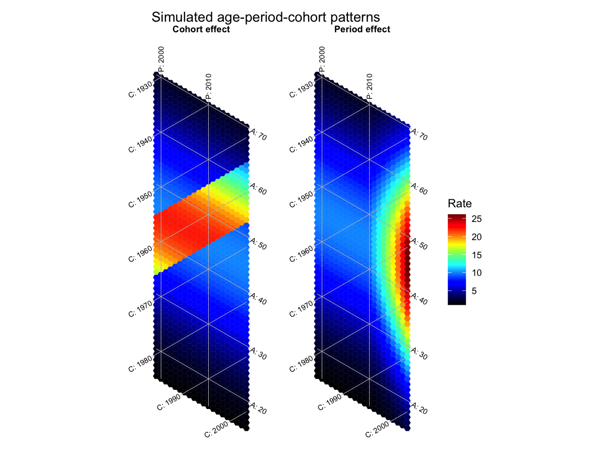

<!-- README.md is generated from README.Rmd. Please edit that file -->

# hexamap 

<!-- badges: start -->

[](https://github.com/CISNET-COBRAS/hexamap/actions/workflows/R-CMD-check.yaml)
[](https://CRAN.R-project.org/package=hexamap)
[](https://lifecycle.r-lib.org/articles/stages.html#stable)
<!-- badges: end -->

**hexamap** draws *hexamaps*: heatmaps of age-period-cohort (APC) data
made of hexagonal tiles, so that age, period and cohort sit on three
axes at equal 60° angles. It implements the method of [Jalal and Burke
(2020)](https://doi.org/10.1097/EDE.0000000000001236).

## Why hexagons?

The traditional Lexis diagram puts period and age on the x and y axes,
which leaves cohorts on the diagonal. Relative to age and period, that
layout

- compresses patterns between adjacent cohorts by about 30%,
- stretches patterns within each cohort by about 41%, and
- lets adjacent tiles along a cohort touch only at a corner.

A hexagonal grid places all three APC axes at equal angles, and adjacent
tiles share a full edge along every axis. Below, the same simulated
rates have a high-risk group of birth cohorts (1955-1965). The band is
easier to follow on the hexamap.

``` r
library(hexamap)

rates <- simulate_apc(
  ages = 15:70, periods = 1999:2018,
  age_effect = function(a) -((a - 45) / 20)^2,
  cohort_effect = function(c) ifelse(c >= 1955 & c <= 1965, 0.8, 0)
)

par(mfrow = c(1, 2))
lexis_map(rates, title_text = "Lexis diagram", legend = FALSE)
hexamap(rates, title_text = "Hexamap", scale_units = "Rate per 100,000")
```



## Installation

Install hexamap from CRAN:

``` r
install.packages("hexamap")
```

or the development version from GitHub:

``` r
# install.packages("pak")
pak::pak("CISNET-COBRAS/hexamap")
```

## Example: drug overdose deaths

`overdose_white_men` has accidental drug overdose death rates among
white men in the United States, by single year of age and calendar year,
from CDC WONDER: the data of Figure 1 in the paper. Ages and years come
from the matrix dimnames, and `highlight` traces one birth cohort.

``` r
hexamap(overdose_white_men,
        colorbar_range = c(0, 40),
        scale_units = "Deaths per 100,000",
        highlight = list(cohort = 1975),
        na_label = "Suppressed",
        title_text = "Drug overdose deaths, white men, US",
        subtitle_text = "Accidental poisoning (ICD-10 X40-X44), 1999-2018")
```



Cells with 9 or fewer deaths are not published by CDC WONDER and are
shown in grey.

## ggplot2

`gg_hexamap()` returns a ggplot object, so titles, themes and other
layers work as usual. A named list of matrices gives one panel per
element with a shared color scale.

``` r
library(ggplot2)

period <- simulate_apc(
  ages = 15:70, periods = 1999:2018,
  age_effect = function(a) -((a - 45) / 20)^2,
  period_effect = function(p) 0.12 * pmax(p - 2010, 0)
)

gg_hexamap(list(`Cohort effect` = rates, `Period effect` = period),
           scale_units = "Rate") +
  labs(title = "Simulated age-period-cohort patterns")
```



## Main functions

| Function | Purpose |
|----|----|
| `hexamap()` | Draw a hexamap with base graphics |
| `lexis_map()` | Draw a traditional Lexis diagram of the same data |
| `gg_hexamap()`, `autoplot()` | Draw hexamaps and Lexis diagrams with ggplot2 |
| `hexamap_layout()` | Compute tiles, colors and isolines without drawing |
| `simulate_apc()` | Simulate rates from age, period and cohort effects |
| `as_apc_matrix()`, `apc_rates()` | Prepare age-by-period matrices from long data or counts |
| `hexamap_palette()` | Jet (as in the paper), viridis and other palettes |
| `apc_to_xy()` | Convert ages and periods to plot coordinates for annotations |

## Learn more

- `vignette("hexamap")`: getting started, from data preparation to
  isolines, colors, layouts and ggplot2.
- `vignette("apc-patterns")`: what age, period and cohort effects look
  like, alone and combined, on hexamaps and Lexis diagrams.
- `vignette("overdose")`: the drug overdose example of the paper.

## Citation

If you use hexamap, please cite the paper:

> Jalal H, Burke DS. Hexamaps for age-period-cohort data visualization
> and implementation in R. *Epidemiology*. 2020;31(6):e47-e49.
> <https://doi.org/10.1097/EDE.0000000000001236>

Run `citation("hexamap")` for BibTeX entries of the paper and the
package.

## Authors and funding

hexamap is developed by Hawre Jalal (University of Ottawa) and Fernando
Alarid-Escudero (Stanford University), and supported by the National
Cancer Institute’s Cancer Intervention and Surveillance Modeling Network
(CISNET) grants U01CA319218, U01CA319117 and U01CA319219.
